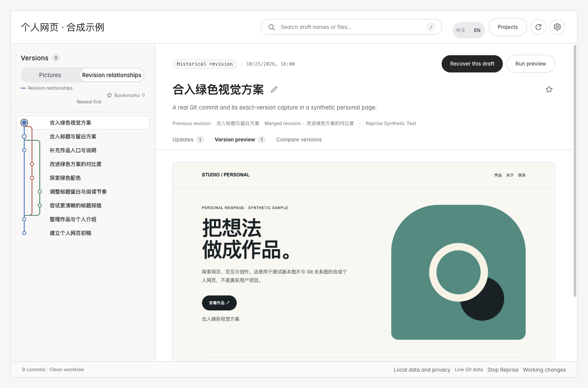
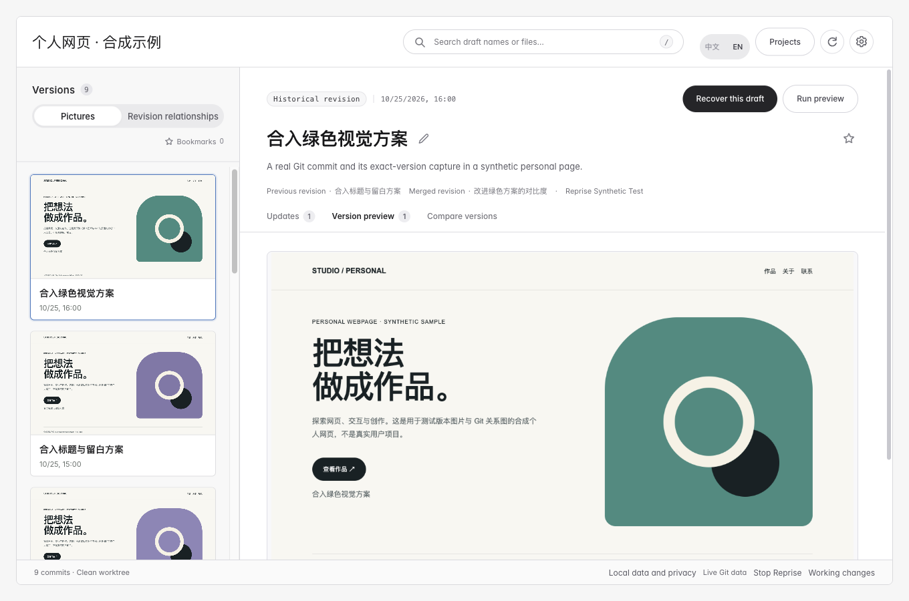

# Reprise / 倒带

**Save local webpage drafts, find them by picture, and follow real Git branches and merges.**

Want to try an earlier look after several edits? Reprise brings version files, matching pictures and revision relationships into one local workbench. Select an old draft, compare changes and recover a new copy to keep editing.

[简体中文](README.md) · [Download Skill](https://github.com/orocoa/Reprise/releases/download/v0.8.0/Reprise-Skill.zip) · [Quickstart](docs/QUICKSTART.md#english) · [All features](docs/FEATURES.en.md)



*Actual workbench using a synthetic personal webpage. Previous visual archives and pictures remain available.*

## Find the version by picture or relationship

- **Recognize its appearance.** Browse each version’s own picture, title and time. Search, bookmark and compare any two versions’ images and files.
- **Follow the Git route.** Browse real branches and merges in a subway-style graph. Select a node to inspect its version. Lanes and colors are layout; parent relationships come from Git.
- **Keep editing a recovered copy.** Retrieve a complete draft or selected files into a new folder, verify the result and copy continuation instructions for your editing agent.

Folders can be saved without an existing Git repository. Existing Git histories are read-only. Folder save order and source-repository branch history remain distinct. Pictures must be captured or imported; missing images stay visibly missing.



## Start with your agent

1. Give the complete **Reprise-Skill.zip** to an agent with local file and command access: **“Install Reprise, reuse existing tools, install anything missing through official methods, then open it.”**
2. In your webpage conversation, say **“Save a draft before and after this edit.”** On the folder project’s first save, answer once whether future drafts should include images. The answer persists across failures and restarts.
3. Open the workbench, select a draft by image or route and choose **Recover this draft**. Check the new copy, then paste its continuation instructions into your editing agent.

For existing Git history, ask **“Open this repository’s revision relationships and available previews in Reprise.”** It does not create commits or rewrite the source repository.

Save before edits overwrite a draft. Opening only opens the workbench; there is no background recording of every edit. File saving, image completion and application execution are separate results.

## Tools and scope

The main delivery is a source Skill and local workbench. No extra AI key is required. The standard-library Python core needs Python 3.9+ and Git; automatic pictures also need Node, Node Playwright and a usable browser. Your agent reuses tools before filling gaps. [Setup and direct commands](docs/AGENT-SKILL.md#english)

Static HTML can prepare direct captures. Supported standalone npm/Vite projects first propose install/run commands for approval in a separate copy. Other projects use explicit settings or manual images. Historical application execution is not guaranteed.

Backup/migration, old-copy imports, integrity and storage tools remain under optional settings. General expansion is frozen while observed workflow problems are improved. [Feature scope](docs/FEATURES.en.md) · [Git graph contract](docs/GIT-GRAPH.md) · [Verification](docs/VALIDATION-0.8.0.md)

<details>
<summary>Developers: source and tests</summary>

```sh
python3 run.py
PYTHONPATH=src python3 -m unittest discover -s tests -v
npm test
```

Real browser tests opt in with `REPRISE_BROWSER_TESTS=1` and require capture tools. See [release checks](docs/RELEASE-CHECKLIST.md).

</details>

The local library is unencrypted and does not replace an independent backup. Agent tool output may enter its model context. [Privacy](docs/PRIVACY.md) · [Report a concrete result](https://github.com/orocoa/Reprise/issues/new/choose)

[MIT](LICENSE) · [Third-party notices](THIRD-PARTY-NOTICES.md) · [Contributing](CONTRIBUTING.md)
