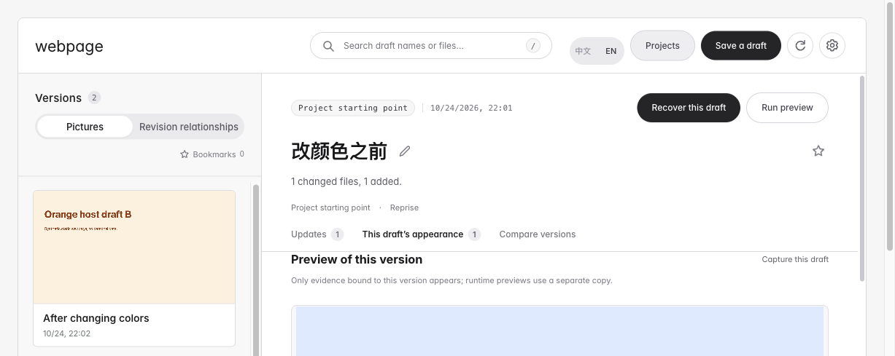

# Reprise · 倒带

**Save a local webpage draft. Find it later by its picture.**

You changed a site with an AI agent or editor and now want the earlier colors—but cannot remember which draft had them. Reprise keeps the files and pictures you explicitly save, helps you recognize the old draft, and retrieves a copy to keep editing.

[简体中文](README.md) · [Download Skill](https://github.com/orocoa/Reprise/releases/download/v0.8.0-rc.1/Reprise-Skill.zip) · [Documentation](https://orocoa.github.io/Reprise/en/index.html) · [Quickstart](docs/QUICKSTART.md#english)



## Three steps

1. Give the complete `Reprise-Skill.zip` to an agent with local tool access: **“Install Reprise and open it.”**
2. In a conversation where the website project is clear: **“Save this draft as ‘Before changing the colors’, including its screenshot.”** Make a change, then save another draft with its picture.
3. Select Reprise and say “Open.” Recognize the draft by its picture, title and time, then use **Recover this draft** to retrieve a new folder and keep editing. The current project stays intact.

Save before editing. Reprise does not record every change or recover drafts never saved. Opening does not save or import the current directory. Use your client’s actual [Skill entry](docs/AGENT-SKILL.md#english); there is no claimed universal `@` alias.

## Scope

For people repeatedly editing **their own local webpage projects** with an AI agent or editor and needing visual draft history. This is local file history, not an online URL bookmark service.

Static HTML with a clear entry and local assets can attempt capture directly. Supported standalone npm/Vite projects save first, then present an install-and-run plan. Approved commands run in a separate copy. Next, custom builds and remote services still need run settings. Saved files and pictures have separate outcomes; a missing picture is never substituted from another revision.

## Setup and verification

This is the [0.8.0 preview release](https://github.com/orocoa/Reprise/releases/tag/v0.8.0-rc.1). It contains a Skill, scripts and workbench source. The agent reuses available tools and helps install missing dependencies through official methods and normal host authorization. Ordinary users do not assemble environment variables or configure another AI key.

Core operations need **Python 3.9+ and Git**. Automatic pictures also need **Node, the Node Playwright library and a usable browser**. Python 3.9 is the compatibility floor; choose a maintained release for new installs. The complete runtime test bundle was withdrawn; no bundled-Python installer is offered.

The macOS + Codex run installed the final Skill, verified discovery, opened an empty workbench, saved two actual pictures, recovered the old draft to a default new folder, checked bytes, switched languages, stopped and reopened. Fresh-machine dependency setup and native WorkBuddy/TRAE use remain unverified. See [verification scope](docs/VALIDATION-0.8.0.md).

<details>
<summary>Developers: run and check the source</summary>

```sh
python3 run.py
PYTHONPATH=src python3 -m unittest discover -s tests -v
npm test
```

The Python core uses the standard library. Prepare capture dependencies in Reprise’s own tools directory, outside managed website sources. The source Skill uses `scripts/reprise.py`; the repository also provides `scripts/start_workbench.py`. See [environment details](docs/AGENT-SKILL.md#english).

</details>

The local library is unencrypted, and snapshots do not replace independent backups. Agent tool output may enter its model context. See [privacy](docs/PRIVACY.md).

[Report a concrete result](https://github.com/orocoa/Reprise/issues/new/choose): what draft you wanted, whether you recovered it and what was difficult. Do not include private files or full local paths. Stars show interest; successful use and reuse need separate evidence.

[MIT](LICENSE) · [Third-party licenses](THIRD-PARTY-NOTICES.md) · [Contributing](CONTRIBUTING.md)
