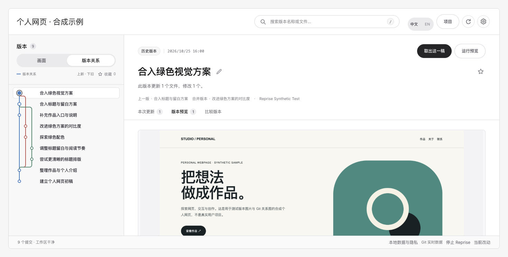
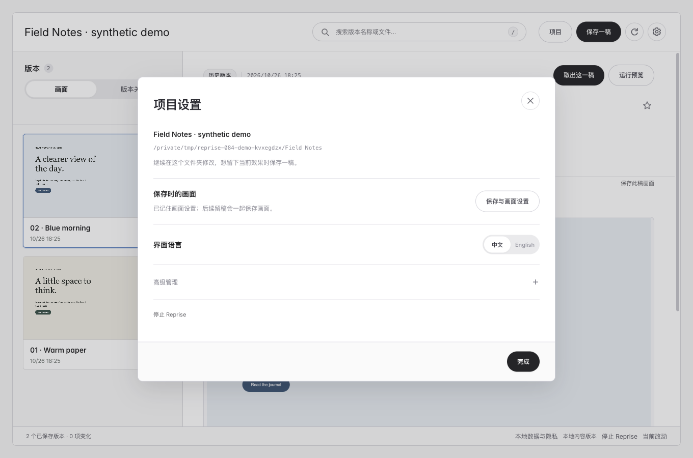
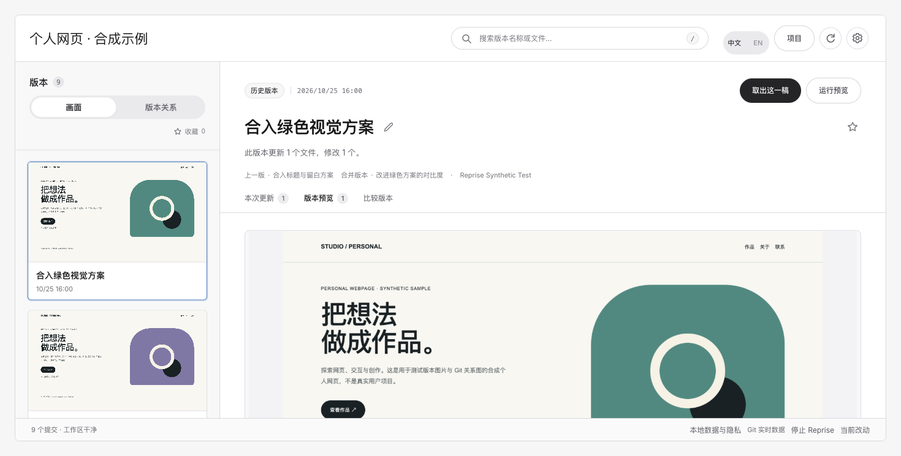

# 倒带 / Reprise

**给本地网页留稿，凭画面找回，取出副本继续设计。**

Reprise 帮助使用 Agent 或编辑器制作网页的设计师保存关键稿件，把版本文件、对应画面和版本关系放在一个本地工作台里。选中旧稿，比较变化，再取出新副本继续改。

[English](README.en.md) · [下载 Skill](https://github.com/orocoa/Reprise/releases/download/v0.8.4/Reprise-Skill.zip) · [快速开始](docs/QUICKSTART.md) · [完整功能](docs/FEATURES.md)



*版本关系与图片列表为 0.8.2 留存合成样例；本次设置界面见下图。*

**0.8.4 更新：** 语言切换集中到设置；胶囊更紧凑，移除两项冗余设置，高级管理支持平滑展开与收起。[本次更新](CHANGELOG.md#084--2026-10-26--更简洁的设置与平滑展开)



## 两种方式，找到同一稿

- **按画面认稿。** 看每一稿自己的截图、名称和时间，收藏、搜索，比较任意两版的图片与文件。
- **沿 Git 路线看演变。** 像地铁线一样浏览真实提交的分叉与合并，点击节点查看该版本。颜色与轨道用于排版，每条父子关系来自 Git。
- **取出副本继续改。** 整稿或指定文件恢复到新目录，校验后给出继续编辑指令，当前项目保留原样。

没有 Git 也能主动保存文件夹稿件；已有 Git 项目可以只读浏览提交历史。两者独立：文件夹保存顺序不冒充源仓库的分支历史。截图需要实际生成或导入，缺图明确显示。



## 交给 Agent，开始使用

1. 下载完整 **Reprise-Skill.zip**，交给有本机文件与命令能力的 Agent：**“帮我安装倒带 / Reprise，复用现有环境，缺少的依赖按官方方法安装，然后打开。”**
2. 在正在修改网页的对话里说：**“本轮修改前后都帮我留稿。”** 首次为文件夹项目留稿时，只问一次以后是否需要画面；答案按项目保存，后续沿用，失败或重启不重置。
3. 打开工作台，按图或版本路线选旧稿，点 **“取出这一稿”**。核对新副本，再复制继续修改指令给你的编辑 Agent。

想看已有 Git 历史，可以直接说：**“用 Reprise 打开这个仓库的版本关系和已有预览。”** 不会替你提交或改写源仓库。

必须提前保存，未保存的内容无法事后找回。“打开”只打开工作台；没有后台记录每次编辑。文件保存、画面完成和网页能运行分别报告。

## 环境与范围

主要交付是源码 Skill 和本地工作台，不需要额外 AI Key。Python 核心只用标准库，需要 Python 3.9+ 与 Git；自动截图另需 Node、Node 版 Playwright 和可用浏览器。Agent 先复用工具，再补齐缺项。[安装与直接命令](docs/AGENT-SKILL.md)

静态 HTML 可准备直接截图；受支持的独立 npm/Vite 项目先给出安装与运行计划，批准后在独立副本执行。其他项目使用明确配置或手工图片，不保证任意历史版本都能运行。

备份迁移、旧副本导入、完整性与存储管理保留在设置的按需入口。当前冻结通用功能扩展，继续修复实际使用问题。[功能范围](docs/FEATURES.md) · [Git 图规则](docs/GIT-GRAPH.md) · [验证范围](docs/VALIDATION-0.8.4.md)

<details>
<summary>开发者：源码启动与测试</summary>

```sh
python3 run.py
PYTHONPATH=src python3 -m unittest discover -s tests -v
npm test
```

真实浏览器测试设置 `REPRISE_BROWSER_TESTS=1` 并提供截图环境。完整命令见[发布验收](docs/RELEASE-CHECKLIST.md)。

</details>

本地库未加密，不替代独立备份；Agent 工具输出可能进入其模型上下文。[隐私](docs/PRIVACY.md) · [反馈一次具体使用结果](https://github.com/orocoa/Reprise/issues/new/choose)

[MIT](LICENSE) · [第三方许可](THIRD-PARTY-NOTICES.md) · [参与项目](CONTRIBUTING.md)
