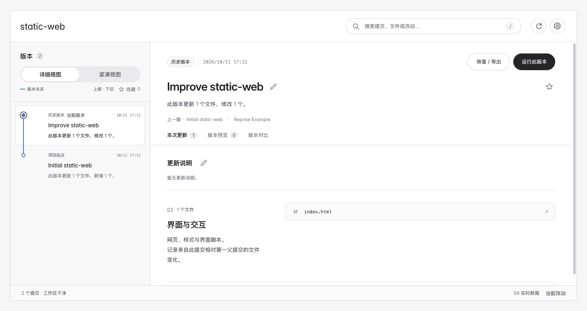

# Reprise · 倒带 — Local Git History Browser

[简体中文](README.zh-CN.md)

[](https://github.com/orocoa/Reprise/actions/workflows/ci.yml)

Reprise is a **local Git history browser** by [orocoa](https://github.com/orocoa): compare commits and files, preview configured versions in **isolated copies**, and restore or export snapshots. Core history and diff workflows need **Python 3.9+ and Git**; they do not require an AI connection. Release notes and previews can be edited by hand or optionally with AI.



Captured from a local run using the repository's generated `static-web` example, with two real Git commits.

**Get started:** [Install the agent skill](docs/AGENT-SKILL.md) · [Releases](https://github.com/orocoa/Reprise/releases/latest) · CLI below.

## Install the skill (recommended)

Download the [portable skill ZIP](https://github.com/orocoa/Reprise/releases/latest/download/reprise-skill.zip) or [WorkBuddy skill ZIP](https://github.com/orocoa/Reprise/releases/latest/download/reprise-workbuddy.zip). Keep the full `reprise/` directory and let your local agent follow `SKILL.md`. Requires Python 3.9+ and Git; no pip install and no native app.

In the target project, ask the agent to open history, compare files, configure an isolated preview, or restore a commit to a new folder / ZIP. Details: [docs/AGENT-SKILL.md](docs/AGENT-SKILL.md).

## Command-line setup (optional)

```sh
git clone https://github.com/orocoa/Reprise.git
python3 -m venv ~/.venvs/reprise
~/.venvs/reprise/bin/python -m pip install ./Reprise
source ~/.venvs/reprise/bin/activate
```

In any Git repo:

```sh
reprise .
reprise . --no-browser --lang en
reprise shutdown
```

Data lives under `~/Library/Application Support/Reprise` (macOS) or `$XDG_DATA_HOME/reprise` (Linux), outside the imported repo.

Previewing a historical page also needs that version's dependencies and a saved runtime configuration. Importing a repository does not install dependencies or run its commands. Approved commands run on your machine; isolated copies are not containers. The `network: local` option limits the capture browser, not approved install or build commands.

Stop Reprise with the same data directory before upgrading or backing it up. Preserve the complete application data directory and back up source repositories separately. Application data may contain API keys and should remain private. Existing copies, media, logs, and failed captures are retained.

## What it is / is not

| Is | Is not |
| --- | --- |
| A readable UI over **existing Git history** | A hosted SaaS or cloud sync product |
| Preview in **isolated copies** when runtime is configured | A guarantee that every historical commit will build |
| Python + Git core; AI optional | An agent that silently rewrites your main working tree |

## More

[Full user guide (Chinese)](docs/USER-GUIDE.zh-CN.md) preserves the previous detailed README, including automatic capture setup, runtime configuration, cancellation, backup and upgrade instructions.

[Agent skill guide](docs/AGENT-SKILL.md) · [Capture recipes](docs/RECIPES.md) · [Architecture](docs/ARCHITECTURE.md) · [Validation](docs/VALIDATION.md) · [Release checklist](docs/RELEASE-CHECKLIST.md) · [CI](https://github.com/orocoa/Reprise/actions) · [Issues](https://github.com/orocoa/Reprise/issues)

Code is MIT licensed; fonts, icons and imported media retain their own terms. See [LICENSE](LICENSE) and [third-party notices](THIRD-PARTY-NOTICES.md).
