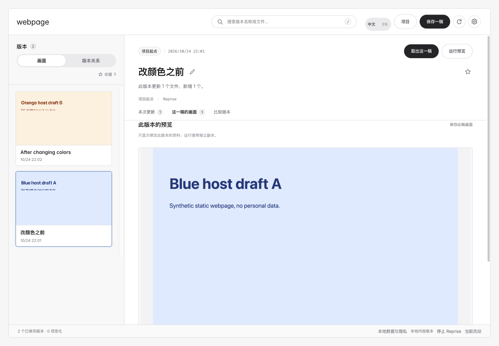

# 倒带 / Reprise

**给本地网页留一稿，以后凭画面找回来。**

和 AI agent 或编辑器改了几版网页，想找回之前的配色，却记不清是哪一稿？Reprise 保存你主动留下的文件和对应画面，帮你认出旧稿，再取出副本继续修改。

[English](README.en.md) · [下载 Skill](https://github.com/orocoa/Reprise/releases/download/v0.8.0-rc.1/Reprise-Skill.zip) · [使用文档](https://orocoa.github.io/Reprise/zh/index.html) · [首次接入](docs/QUICKSTART.md)



## 三步使用

1. 把完整的 `Reprise-Skill.zip` 交给有本机操作能力的 agent，说：**“帮我安装倒带 / Reprise 并打开。”**
2. 在网页项目已经明确的对话里说：**“保存当前网页这一稿，叫‘改颜色之前’，同时记住画面。”** 修改后再保存一稿和画面。
3. 选择 Reprise Skill，说“打开”。按截图、名称和时间认出旧稿，点**「取出这一稿」**，取到新文件夹继续改。当前项目保留原样。

必须在修改前主动保存。Reprise 不会自动记录每次编辑，也无法找回从未保存的稿件。只说“打开”不会保存或导入当前目录。各客户端的实际 Skill 入口见[接入说明](docs/AGENT-SKILL.md)；不承诺通用 `@` 别名。

## 适用范围

面向用 AI agent 或编辑器反复修改**自己电脑里的网页项目**、需要凭画面认稿的人。它保存本地文件版本，不是线上网址收藏夹。

入口明确、素材在本机的静态 HTML 可以尝试直接出图。受支持的独立 npm/Vite 项目会先保存文件，再提出安装和运行计划；命令经批准后在独立副本执行。Next、自定义构建和远程服务仍需明确运行配置。文件保存和画面完成分别报告，缺图不会借另一稿填补。

## 安装与当前验证

这是 [0.8.0 预览发布](https://github.com/orocoa/Reprise/releases/tag/v0.8.0-rc.1)。主要交付为 Skill、脚本和工作台源码；agent 先复用环境，缺少依赖时按官方方法和宿主正常授权协助安装。普通用户不需要手填环境变量，也不需要额外 AI Key。

基础操作需要 **Python 3.9+ 与 Git**；自动截图另需 **Node、Node 版 Playwright 和可用浏览器**。3.9 是代码兼容下限，新装请选择仍维护的版本。完整运行测试包已撤回，不提供自带 Python 的安装包。

本机 macOS + Codex 已实际完成：安装最终 Skill、技能发现、打开空工作台、两稿真实画面、按图恢复到默认新目录、逐字节核验、切换中英文、停止后重开。新机器补齐依赖及 WorkBuddy/TRAE 原生接入仍未验证。详见[验证范围](docs/VALIDATION-0.8.0.md)。

<details>
<summary>开发者：直接运行与检查</summary>

```sh
python3 run.py
PYTHONPATH=src python3 -m unittest discover -s tests -v
npm test
```

Python 核心仅用标准库。截图依赖在 Reprise 自己的工具目录准备，不安装进受管网页源目录。源码 Skill 的入口是 `scripts/reprise.py`，完整仓库也可使用 `scripts/start_workbench.py`。详细环境与运行命令见[接入说明](docs/AGENT-SKILL.md)。

</details>

本地版本库未加密，快照不能代替独立备份。Agent 的工具输出可能进入其模型上下文。见[隐私说明](docs/PRIVACY.md)。

如果试过，欢迎[记录一个具体结果](https://github.com/orocoa/Reprise/issues/new/choose)：想找哪一稿、是否找回、哪里麻烦。无需附私人文件或完整本机路径。Star 表达关注，真实完成和再次使用需要另行验证。

[MIT](LICENSE) · [第三方许可](THIRD-PARTY-NOTICES.md) · [参与项目](CONTRIBUTING.md)
