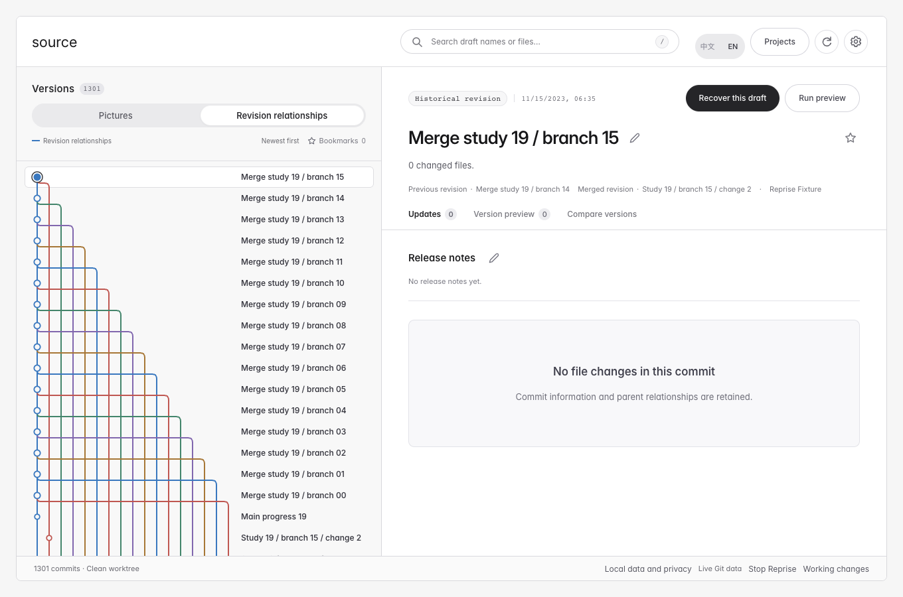

# Reprise 0.8.0 验证范围 / Verification scope

2026-10-26 · 维护者测试记录。合成压力样本、真实项目只读检查、独立安装和外部用户采用分别记录。

## 当前交付与身份

主附件为 `Reprise-Skill.zip`。本包从干净提交 [`b9305bf`](https://github.com/orocoa/Reprise/commit/b9305bf1d2d55535ad2e90fa7ac1c58110e37ea3) 构建；发布标签另外包含文档与校验值更新，包内功能文件与标签源码逐字节核对。清单、CRC、基础工具和实际安装入口均单独验证。

SHA-256：`48b7095ef1631286b7fbc5d84a2e9911d2639dba2084dad139991f7bb2e322d1`。

## 已实际验证

| 范围 | 验证内容 |
| --- | --- |
| 首次选择与留稿 | 按文件夹项目先保存截图是/否，跨独立进程持续沿用；失败与待配置不清掉选择；不把截图意图当作命令批准。 |
| 版本图片与关系图 | 只保留画面缩略图和固定紧凑路线。全 SHA、全部有序父边、搜索/收藏/选中后的同一图模型、旧稿跨视图定位与缺图空状态。 |
| 大历史 | 合成仓库使用 1301 个真实 Git 提交对象、1620 条父边、16 路并行与 320 个合并节点。逐项核对拓扑、避碰、所有圆点对齐、可读标题、文件搜索与移动横向阅读。图片列表定位旧稿最多补一张所选卡片。 |
| 实际已有项目 | 当前 PersonalWeb 可达历史只读显示；核对 24,240 个 Git 文件指纹未变。此项目当前可达历史为 9 个提交，不将它作为千版本压力证据。 |
| 恢复与继续 | 在合成个人网页按蓝色旧稿选中并恢复，逐字节核对后修改副本并再次留稿；原网页与 Git 元数据 55 个文件指纹未变。整稿继续指令的路径与完整 SHA 正确。 |
| 安装与兼容 | 本机 Skill 更新保留旧入口与旧运行时。正式包与安装过程生成的包字节一致；wheel、源码包重建 wheel 的 venv/user-site 四条路径在源码外运行。WorkBuddy 元数据包保留为格式兼容交付。 |
| 高级能力 | 备份/恢复/迁移、旧目录与 ZIP、完整性/存储、删除影响及保留版本核验、环境释放、任务取消与协议边界由回归覆盖；实际删除演练仅用合成资料。 |



在本机压力演练中，首屏约 0.8 秒；首次为全部 1301 版建立文件检索约 25 秒，之后复用索引。搜索显示进度，清空或选中关系节点可取消。该数字不是其他机器的性能保证。宽分支超出可用宽度时横向滚动，不删边省空间；每来源最多 64 个 tip、每 tip 最多 2000 提交，未加载父版本保留边界。

## 重现与发布门槛

```sh
PYTHONPATH=src python3 -m unittest discover -s tests -v
node --test tests/*.test.cjs
python3 scripts/check_distribution.py
```

真实浏览器测试需设置 `REPRISE_BROWSER_TESTS=1` 并提供 `REPRISE_NODE`、`REPRISE_PLAYWRIGHT` 与可用浏览器。公开发布以前，核对对应提交的[完整 CI 实际结果](https://github.com/orocoa/Reprise/actions/workflows/ci.yml)。测试、失败诊断和中间包均由维护者保留；失败与修复后结果分别记录。

## 未据此证明的范围

本机已有工具环境不代表全新机器的缺依赖安装已通过。原生文件选择器/聊天输入框、其他 Agent 客户端原生接入、所有框架、任意规模历史、外部 API/数据库恢复及独立用户复用仍未由本轮证明。可选 AI 接口使用模拟协议回归，未调用真实模型。静态原生壳测试不等于原生应用体验验收。

[Git 图契约](GIT-GRAPH.md) · [功能范围](FEATURES.md) · [上一预览版记录](https://github.com/orocoa/Reprise/blob/v0.8.0-rc.1/docs/VALIDATION-0.8.0.md)

## English

The source Skill is built from clean commit `b9305bf`; the release tag adds documentation/checksum updates with byte-identical functional payload. Manifest, CRC, installed entry and four outside-source wheel/sdist installation paths are verified separately.

The workbench retains only picture thumbnails and the fixed compact relationship graph. A synthetic repository contains 1301 real Git objects, 1620 ordered parent edges, 16 parallel paths and 320 merge nodes. Tests check exact topology, lane avoidance, every node’s alignment, readable titles, search, mobile horizontal access and old selections beyond the first 60 thumbnails. The actual PersonalWeb read-only check has 9 reachable commits and preserves 24,240 Git files; it is distinct from the scale fixture.

An earlier blue synthetic webpage was recovered by picture, read back, edited as an independent copy and saved again. The source and its Git metadata remained unchanged. On this host the scale graph became ready in about 0.8 seconds; the first complete file index took about 25 seconds and is reused. These timings are host-specific.

Use the commands above and the exact commit’s CI results. Fresh-machine dependency setup, native pickers/composers, native use in other agents, every framework, unlimited history and independent adoption are not established. AI protocol tests use stubs, and retained native-shell tests do not prove the native application experience.
